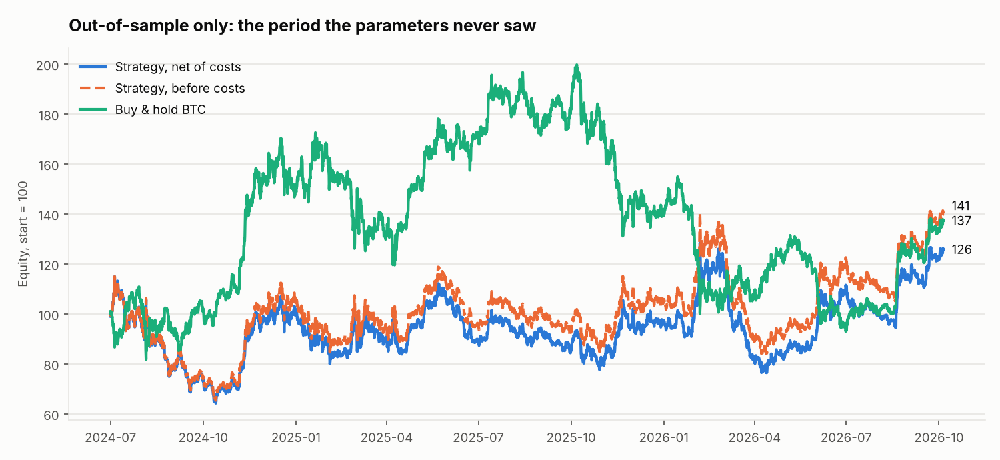
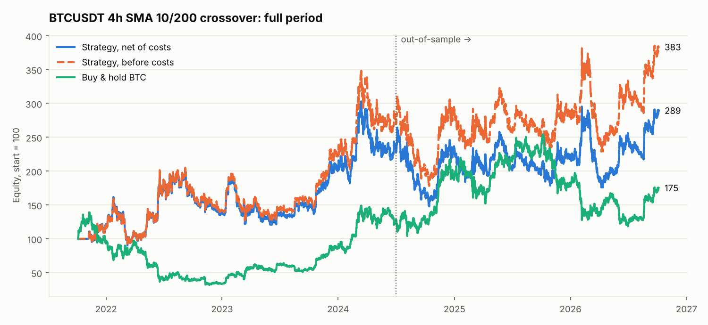
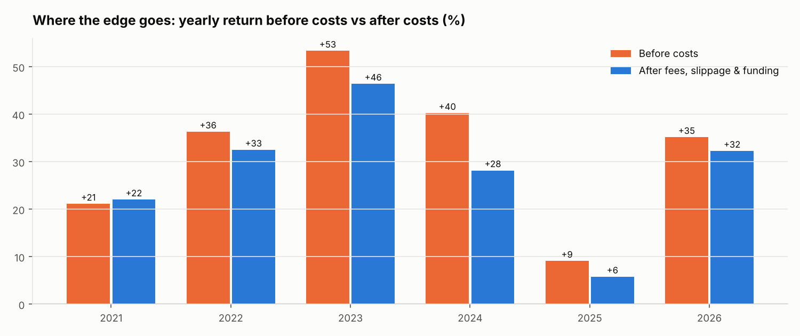

# Honest Backtest: BTCUSDT trend-following with real costs

A small, reproducible backtest that shows **how a strategy's result changes once you stop fooling yourself**:
realistic fees, slippage and funding, parameters picked on one period and judged once on a period they never saw.

The strategy itself is deliberately simple (4h SMA crossover, long/short on a BTCUSDT perpetual).
The point of this repo is the **method**, not the strategy.

## What it does

1. `download_data.py` - downloads BTCUSDT 15m candles and funding history from the public Bybit v5 API (saved next to the scripts).
2. `backtest.py` - resamples to 4h, runs a grid of 15 SMA (fast, slow) pairs, and writes the charts and `summary.md`.

Rules that keep it honest:

- **No look-ahead.** Signal is computed on a closed bar; the position is taken at the *next* bar.
- **Costs on every position change:** taker fee 0.055% + slippage 0.02% per side.
- **Real funding payments** from exchange history, charged to whichever position was open at each settlement.
- **In-sample / out-of-sample split** (2024-07-01). Parameters are chosen on in-sample by net Sharpe,
  then evaluated **once** on out-of-sample. No re-tuning after looking.
- **Benchmark:** buy & hold BTC over the same window.

## Result (SMA 10/200 selected on in-sample)

| | In-sample (net) | Out-of-sample before costs | Out-of-sample net | Buy & hold (OOS) |
|---|---|---|---|---|
| Total return | +132.7% | +40.9% | +25.9% | +37.4% |
| CAGR | +36.1% | +16.4% | +10.7% | +15.1% |
| Max drawdown | -44.3% | -43.1% | -44.1% | -53.4% |
| Sharpe | 0.84 | 0.56 | 0.45 | 0.53 |





## Honest conclusion

- In-sample looked great (+133%). Out-of-sample the strategy made +26% net, **less than simply holding BTC (+37%)**,
  with a somewhat smaller drawdown.
- Costs ate roughly **a third of the gross out-of-sample return**: 7.7% in fees and slippage plus 3.6% in funding.
- This is what most "profitable" backtests look like once done properly. A report that says so is more useful
  than a pretty curve that falls apart live.

## Run it

```bash
pip install -r requirements.txt
python download_data.py      # optional: the CSVs in the repo are a snapshot
python backtest.py           # writes *.png and summary.md
```

Python 3.10+. To test your own idea, replace the signal in `run()`; the cost, funding and split logic stays as is.

## Can be adapted to

Other symbols and timeframes, other exchanges (Binance, OKX), walk-forward instead of a single split,
position sizing and stops, bootstrap confidence intervals on per-trade returns.
